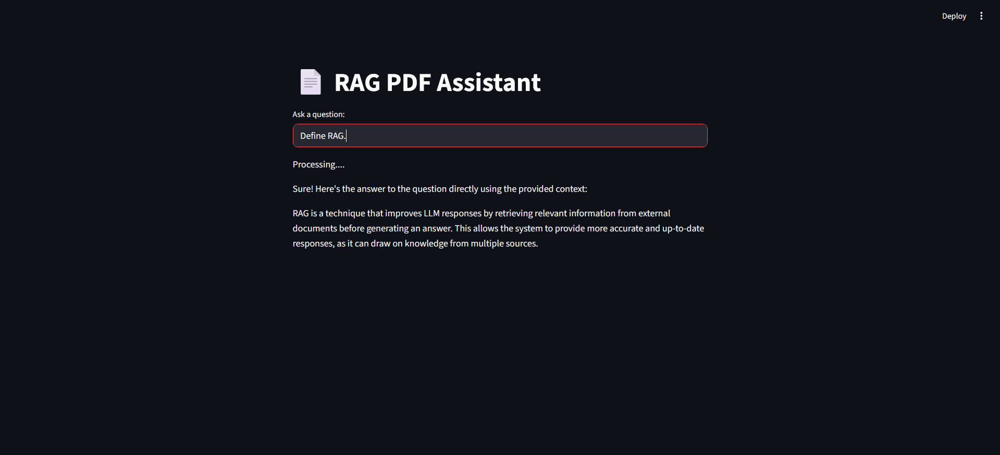

# 🤖 Agentic RAG Assistant

A local Retrieval-Augmented Generation (RAG) system that allows users to ask questions about PDF documents and receive context-grounded answers using a local LLM.

The project combines semantic search (FAISS) and keyword search (BM25) through Hybrid Retrieval, improving document understanding and retrieval quality.

---

## 🚀 Features

* PDF document ingestion
* Automatic document chunking
* Hybrid Retrieval (FAISS + BM25)
* Local embeddings using Nomic Embed Text
* Local LLM inference using Qwen2.5:1.5B via Ollama
* Context-grounded question answering
* Streamlit-based interactive UI
* Agent thought-process visualization
* Source chunk inspection
* RAG evaluation with Faithfulness and Answer Relevancy metrics

---

## 🏗️ Architecture

PDF → Document Loader → Text Chunking → Embeddings → FAISS Vector Store

↓

BM25 Retriever

↓

Hybrid Retriever (Ensemble)

↓

Qwen2.5:1.5B

↓

Final Answer

---

## 🛠 Tech Stack

### Core Frameworks

* Python
* LangChain

### Retrieval

* FAISS
* BM25 Retriever
* Ensemble Retriever

### Embeddings

* Nomic Embed Text (Ollama)

### LLM

* Qwen2.5:1.5B (Ollama)

### Evaluation

* Gemini 2.5 Flash
* Faithfulness Scoring
* Answer Relevancy Scoring

### Interface

* Streamlit

---

## 📂 Project Structure

```text
agentic-rag-assistant/
│
├── app.py
├── app_ui.py
├── evaluation.py
│
├── src/
│   ├── load_docs.py
│   ├── chunk_docs.py
│   ├── vector_store.py
│   └── llm.py
│
├── data/
│   └── documents/
│       └── sample_ai_document_for_rag.pdf
│
└── README.md
```

---

## ⚙️ How It Works

### 1. Document Loading

PDF files are loaded using PyPDFLoader.

### 2. Text Chunking

Documents are split into chunks of:

* Chunk Size: 500
* Chunk Overlap: 50

### 3. Hybrid Retrieval

The system combines:

* BM25 keyword retrieval
* FAISS semantic retrieval

Both retrievers contribute equally through an Ensemble Retriever.

### 4. Answer Generation

Retrieved context is passed to Qwen2.5:1.5B running locally through Ollama.

The model is instructed to:

* Answer only from retrieved context
* Avoid hallucinations
* Return a fallback response when information is unavailable

### 5. Source Verification

Retrieved chunks are displayed alongside the answer for transparency.

---

## ▶️ Installation

### Clone Repository

```bash
git clone <repository-url>
cd agentic-rag-assistant
```

### Create Virtual Environment

```bash
python -m venv venv
```

### Activate Environment

```bash
venv\Scripts\activate
```

### Install Dependencies

```bash
pip install -r requirements.txt
```

---

## 📥 Required Ollama Models

Pull the required models:

```bash
ollama pull qwen2.5:1.5b
ollama pull nomic-embed-text
```

---

## ▶️ Run Application

### Terminal Version

```bash
python app.py
```

### Streamlit Interface

```bash
streamlit run app_ui.py
```

---

## 📊 RAG Evaluation

The project includes an evaluation pipeline that measures:

* Faithfulness
* Answer Relevancy

### Run Evaluation

```bash
python evaluation.py
```

### Sample Results

| Metric           | Score |
| ---------------- | ----- |
| Faithfulness     | 0.99  |
| Answer Relevancy | 1.00  |

These results demonstrate that the generated answers remain highly grounded in the retrieved document context.

---

## 📷 Demo

```markdown

```

---

## 🎯 Key Learnings

* Retrieval-Augmented Generation (RAG)
* Hybrid Search Systems
* Semantic Search with Vector Databases
* BM25 Keyword Retrieval
* Local LLM Deployment using Ollama
* Prompt Engineering for Context Grounding
* RAG Evaluation Techniques
* Faithfulness and Relevancy Measurement

---

## 📌 Future Improvements

* Multi-document support
* Query rewriting
* Re-ranking models
* Conversation memory
* Advanced RAG evaluation metrics
* Support for larger local models
* Citation-based answer generation

---

## 👨‍💻 Author

Viraj Garware

Mechanical Engineering graduate transitioning into Generative AI and Machine Learning.

Focused on building practical AI applications involving RAG, LLMs, LangChain, and local AI systems.